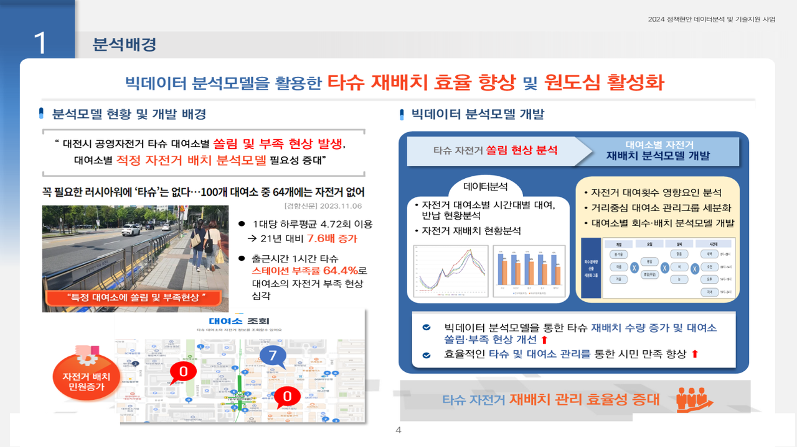
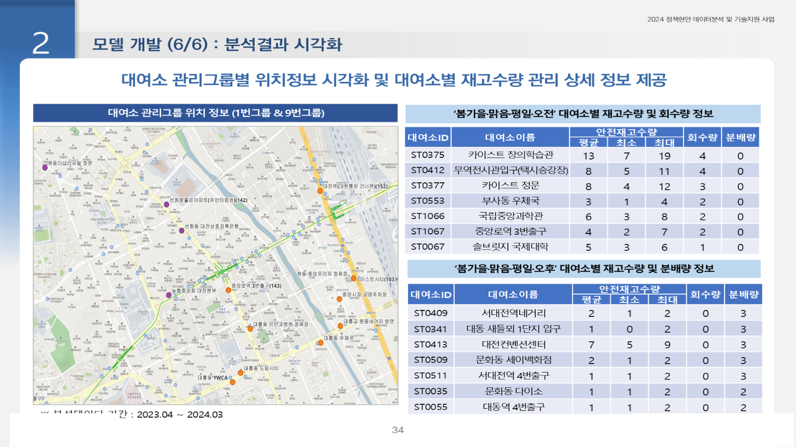

# 대전교통공사 공영자전거(타슈) 이용패턴·재배치 분석

2024.03 – 2024.07 · 라임솔루션 (발주처: 대전교통공사) · 역할: 전처리 · EDA · 통계검증 · K-Means 군집 · QGIS 시각화

## 프로젝트 소개
대전시 공영자전거 타슈의 대여·반납 이력 22개월분을 집계해 어떤 대여소가 언제 비고 넘치는지, 그 원인은 무엇이며 관리구역을 어떻게 나눠야 하는지를 분석했다 (분석방안 2024.04.16, 중간 2024.05.17, 완료보고 2024.07.18).
팀 구성은 본인 + 사수 1명이다. 이 레포에는 **본인이 작성한 스크립트 9개**(전처리·유동인구·현황·영향요인·군집·재고량 평가모델 입력 데이터 생성(모델 자체와 적정/안전재고 산출은 팀 수행, 미포함))를 담았고, **최종 재배치 산식(회수량·분배량)과 재고량 평가모델 본체는 사수 수행**으로 해당 스크립트는 포함하지 않는다.

## 문제 정의
- 배경: 출근시간 대여소 자전거 부족률 64.4%. 대여소별 수요·공급 쏠림으로 재배치 인력·차량 운영 비효율
- 질문: 어떤 대여소가 언제 비고 넘치는가, 그 원인은 무엇이며 관리구역을 어떻게 나눠야 하는가

## 데이터
| 데이터 | 출처 | 규모 | 공개 여부 |
|---|---|---|---|
| 대여·반납 이력 | 대전교통공사 | 22개월 | 비공개 (이용 이력) |
| 대여소·행정동·시간대 정보 | 대전교통공사 | 대여소 단위 | 비공개 (발주처 제공) |
| 기상, 유동인구 | 기상청, 통신사 | 일·시간대 | 유동인구는 계약 데이터로 비공개 |

- **원천 데이터는 포함하지 않는다.** 대신 전처리 스크립트가 읽는 대여이력 컬럼 구조를 따르는 **합성 샘플** `data/sample/rental_events_sample.csv`(200행)와 `stations_sample.csv`(20개 대여소)를 numpy seed 42 난수로 만들어 두었다. 실제 이용 패턴과 무관하다. 컬럼 설명은 `data/sample/README.md`.

## 분석 방법
1. **전처리** (`01_preprocess.py`, `02_preprocess_extra.py`): 결측·중복·오류값 제거(예: 대여/반납 구·동 결측을 대여소 주소에서 보완, 오탈자 구명 정정), 행정동·시간대 코드 정합성 점검, 대여·반납 일시 분해 및 분석 변수 생성, 외부 데이터(KOSIS 인구, 행정경계, 100m 격자) 정리
2. **유동인구** (`03_floating_population.py`): 통신사 유동인구 집계
3. **EDA·현황** (`04_status_analysis.py`, `09_oldtown_status.py`): 월·요일·시간대·날씨별 이용 패턴, 원도심·신도시 이용행동 비교
4. **통계검증·영향요인** (`05_factor_analysis.py`): 대여·반납 차이와 영향요인(요일·날씨·시간대)의 유의성 검정
5. **군집** (`06_clustering.py`): 대여소 좌표 Min-Max 스케일링 후 K-Means(random_state=42, 엘보우 탐색 후 k=10)로 대여소 유형·관리구역 분류
7. QGIS로 대여소 유형·쏠림 패턴 시각화

```mermaid
flowchart LR
  A[대여·반납 22개월 이력] --> B[정제·정합성 점검]
  B --> C[시간대·대여소별 집계]
  C --> D[EDA · 통계검증]
  C --> E[K-Means 대여소 유형화]
  D --> F[재고량 평가모델 · 재배치 산식(팀)]
  E --> F
  F --> G[QGIS 시각화 · 보고]
```

## 기술 스택
Python, Pandas, GeoPandas, Scikit-learn(K-Means, MinMaxScaler), SciPy 통계검정, Matplotlib, QGIS

## 결과
- 쏠림 대여소 패턴 규명, 대여소 유형 분류와 관리구역별 배분 기준 제시
- 선제적 입고·점검 대상 식별 기준 제시, 보유 자전거 수량·관리 인력에 따른 운영 제약 확인
- 최종 재배치 검토를 위한 분석 결과·검증자료 제공 (완료보고서 2024.07.18)




## 실행 방법
- 환경: Python 3.9, `pandas geopandas scikit-learn scipy matplotlib openpyxl` (01은 xls→xlsx 변환에 `pywin32`를 사용, Windows 전용)
- 스크립트는 사내 공통 모듈(`config.config_A03`, `utils.*`)에서 경로·로그 설정을 읽는다. 해당 모듈은 포함하지 않으므로 파일 상단의 `config_info[...]` 경로 블록을 로컬 경로로 바꾸고 `log.*` 호출을 제거해야 한다.
- 실행 순서: `01` → `02` → `03` → `04`/`09` → `05` → `06` → `07` → `10` → `11`
- 코드의 `C:\Windows\Fonts`, `C:\2024_project\...` 등 하드코딩 경로는 **환경에 맞게 수정**한다.

### 파일명 매핑 (원본 → 레포)
| 원본 | 레포 (`src/`) | 내용 |
|---|---|---|
| 01.전처리.py | `01_preprocess.py` | 대여이력·기상·외부데이터 전처리 |
| 02.전처리(2).py | `02_preprocess_extra.py` | 추가 데이터 전처리 |
| 03.유동인구분석(202403).py | `03_floating_population.py` | 유동인구 집계 |
| 04.현황분석.py | `04_status_analysis.py` | EDA·현황 |
| 05.영향요인분석.py | `05_factor_analysis.py` | 영향요인·통계검증 |
| 06.군집분석.py | `06_clustering.py` | K-Means 대여소 유형화 |
| 07.재고량평가모델_데이터생성.py | `07_inventory_model_data.py` | 평가모델 입력 데이터 생성 |
| 09.구도심현황분석(추가).py | `09_oldtown_status.py` | 원도심 추가 현황 |
| 08.재고량평가모델.py, 99.현황분석_모델.py | 미포함 | 팀(사수) 작성 — 재고량 평가모델·재배치 산식 |

## 폴더 구조
```
daejeon-tashu-rebalancing/
├── README.md
├── .gitignore
├── src/                      # 위 매핑표의 10개 스크립트
├── data/sample/
│   ├── rental_events_sample.csv   # 합성 대여이력 200행
│   ├── stations_sample.csv        # 합성 대여소 20개
│   └── README.md
└── docs/images/              # 결과 캡쳐
```

## 참고
- Obsidian 노트: `2024-03_대전교통공사_타슈_재배치`
- 관련 레포: `gwangyang-parking-site-selection`
- 공식 완료보고서(2024.07.18)와 원천 데이터는 발주처 자료로 **비공개**이며 이 레포에 포함하지 않는다.
